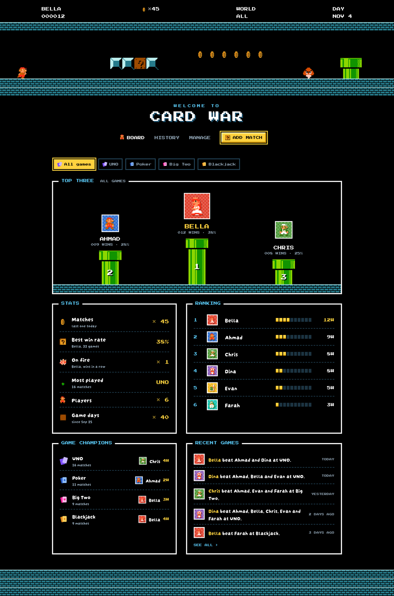
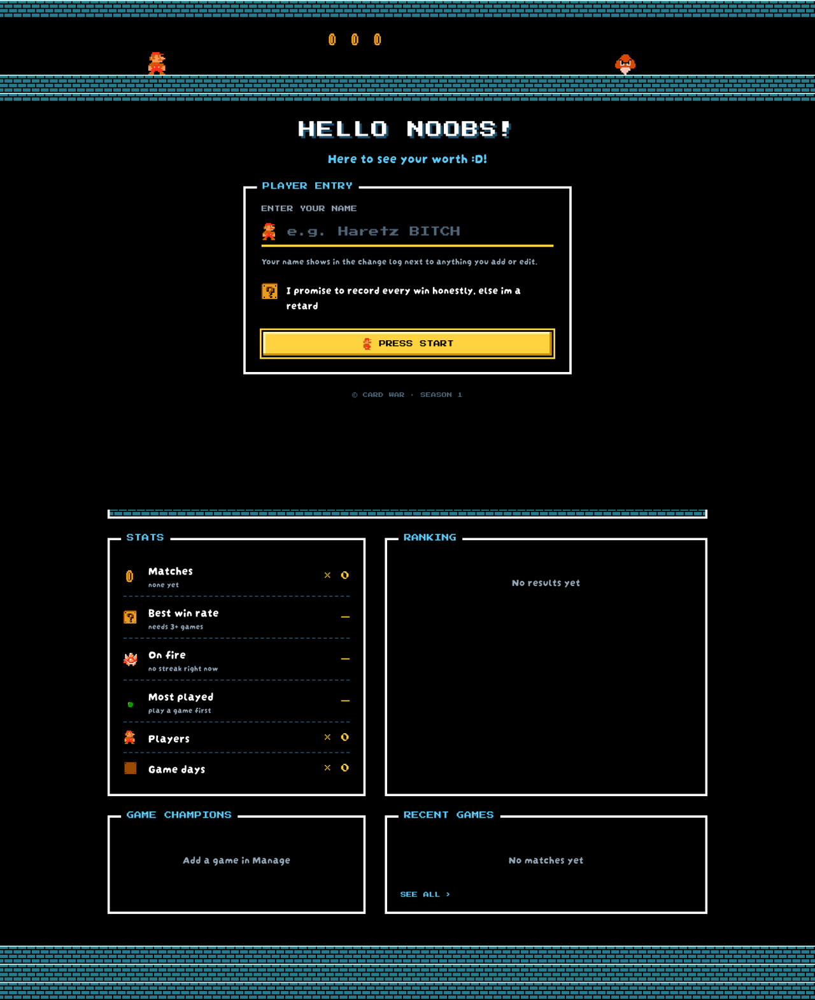

# 🍄 Card War

A Super Mario Bros. (underground World 1-2) themed scoreboard for card-game nights: UNO, Poker, Big Two, Blackjack, or anything else you play.
Record who played and who won, and the dashboard works out the champion, win rates, streaks and the best player for each game.

**Live site:** https://liyohhh.github.io/CardDashboard/



## Features

- **Top Three on pipes:** the leaders stand on green pipes of different heights, and their profile pictures bounce.
- **Game HUD:** the top of the page shows the leader and their wins, coins × matches played, the game being filtered and today's date.
- **Stats, ranking and game champions:** win rates, streaks, most played game, and the best player for each game.
- **Match history:** grouped by date, with filters for game, player and date range; edit or delete any match.
- **Quick match entry:** pick a game (or create one on the spot), set the date, tap who played and who won, add a new player inline.
- **Profile pictures:** every player picks a Mario character, a colour, or uploads a photo (their character then shows as a small badge).
- **Shared and live:** stored in Supabase, so everyone sees the same scores on any device, instantly.
- **Change log** (owner only) and **daily backups** kept for 30 days.
- **Animated cave:** Mario runs through, grabs coins, bumps the ? block and stomps a Goomba (still for people who prefer reduced motion).



## How it works

It's a plain static website (HTML, CSS and JavaScript, no build step) hosted on GitHub Pages, with
[Supabase](https://supabase.com) as the database.

| File | What it is |
|---|---|
| `index.html`, `style.css` | Page layout and styles |
| `app.js` | Dashboard logic: stats, history, players, games, syncing |
| `cave.js` | The animated underground scene |
| `sprites/` | Super Mario Bros. sprites |
| `icons.js` | Game icons |
| `config.js` | Which Supabase project the site uses |
| `supabase-setup.sql` | Database tables, access rules, change log and backups |

Add `?demo` to the address to see the dashboard with sample data without touching the real database.

## Access and safety

Anyone who opens the site can view and edit the scores. People type their name once, and it's shown in the change log.
The Supabase key in `config.js` is a *publishable* key, which is meant to be public. What visitors can do is controlled
by the database's Row Level Security rules in `supabase-setup.sql`. The change log and backups can only be read by the owner account.

## Run your own copy

1. **Fork** this repository (or download it).
2. **Supabase:** create a free project, open **SQL Editor → New query**, paste all of `supabase-setup.sql` and run it.
3. **Owner account:** in **Authentication → Users → Add user**, create a user for yourself, then run:
   ```sql
   insert into public.app_owner (user_id)
   select id from auth.users where email = 'you@example.com'
   on conflict do nothing;
   ```
   Recommended: turn off **Allow new users to sign up** under **Authentication → Sign In / Providers**.
4. **Config:** put your **Project URL** and **publishable key** (Project Settings → API Keys) in `config.js`.
   If you'd rather keep the site private, leave both values empty. Visitors then see a private screen, and you share
   access with an invite link from **Manage → Sharing & sync**.
5. **GitHub Pages:** in your repository, **Settings → Pages → Deploy from a branch → `main` / root → Save**.

## Credits

- Super Mario Bros. sprites via [JuniorTour/es6-mario](https://github.com/JuniorTour/es6-mario). Super Mario Bros., its characters and graphics
  are © Nintendo. This is a private, non-commercial fan project and is not affiliated with Nintendo.
- Game icons: [Streamline](https://www.streamlinehq.com) "Core" flat icons (CC BY 4.0), recoloured.
- Fonts: [Press Start 2P](https://fonts.google.com/specimen/Press+Start+2P) and [Darumadrop One](https://fonts.google.com/specimen/Darumadrop+One) (SIL Open Font License).
